# Laporan Praktikum Jaringan Nirkabel
## Bab 5 Wireless WAN: Analisis Sinyal Seluler Berbasis Software-Defined Radio (SDR)

**Mata Kuliah:** CIF65217 Jaringan Nirkabel  
**Topik:** Bab 5 Wireless WAN: Seluler (GSM, LTE FDD, LTE TDD, & Cell Search)  
**Perangkat & Dataset:** HackRF One SDR, Rekaman IQ (In-phase/Quadrature) `.cs8`, dan Sweep Spektrum `.csv`  

---

## Daftar Isi
1. [Ringkasan Eksekutif](#ringkasan-eksekutif)
2. [Percobaan 1: Peta Spektrum Seluler (700–2700 MHz)](#percobaan-1-peta-spektrum-seluler-7002700-mhz)
3. [Percobaan 2: Analisis Karakteristik Downlink vs Uplink (Band 3 1800 MHz)](#percobaan-2-analisis-karakteristik-downlink-vs-uplink-band-3-1800-mhz)
4. [Percobaan 3: Bentuk Sinyal LTE & Karakteristik OFDMA (1870 MHz)](#percobaan-3-bentuk-sinyal-lte--karakteristik-ofdma-1870-mhz)
5. [Percobaan 4: LTE Cell Search & Ekstraksi MIB (Physical Cell ID 144)](#percobaan-4-lte-cell-search--ekstraksi-mib-physical-cell-id-144)
6. [Percobaan 5: Perbandingan Dupleks FDD vs TDD (LTE Band 40 2300 MHz)](#percobaan-5-perbandingan-dupleks-fdd-vs-tdd-lte-band-40-2300-mhz)
7. [Percobaan 6: Sinyal 2G GSM (TDMA, Multiframe 51, & FCCH 200 kHz)](#percobaan-6-sinyal-2g-gsm-tdma-multiframe-51--fcch-200-khz)
8. [Percobaan 7: Survei & Inventarisasi Sel Lingkungan Kampus](#percobaan-7-survei--inventarisasi-sel-lingkungan-kampus)
9. [Rekonstruksi Peta Kampus: Topologi Tower, Sektor, & Operator](#rekonstruksi-peta-kampus-topologi-tower-sektor--operator)
10. [Diskusi: Analisis Batas Pengamatan SDR pada Arsitektur EPS (4G LTE)](#diskusi-analisis-batas-pengamatan-sdr-pada-arsitektur-eps-4g-lte)
11. [Kesimpulan](#kesimpulan)

---

## Ringkasan Eksekutif

Praktikum ini bertujuan untuk menganalisis karakteristik fisik, struktur transmisi radio (*air interface* $U_u$), dan skema sinkronisasi jaringan seluler generasi kedua (2G GSM) dan generasi keempat (4G LTE) menggunakan rekaman sinyal riil dari perangkat *Software-Defined Radio* (HackRF One). Melalui pendekatan *digital signal processing* (DSP) berbasis Python, dilakukan investigasi terhadap alokasi spektrum frekuensi nasional di Indonesia (B8 900 MHz, B3 1800 MHz, B1 2100 MHz, dan B40 2300 MHz), perbandingan mekanisme dupleks *Frequency Division Duplex* (FDD) dan *Time Division Duplex* (TDD), dekonstruksi struktur simbol OFDMA (Cyclic Prefix dan ortogonalitas subcarrier 15 kHz), proses *cell search* LTE (deteksi PSS, SSS, decoding MIB pada PBCH), keteraturan burst TDMA GSM 4,615 ms, serta pemetaan sel-sel seluler di lingkungan sekitar.

---

## Percobaan 1: Peta Spektrum Seluler (700–2700 MHz)

### 1.1 Deskripsi & Dasar Teori
Spektrum elektromagnetik merupakan sumber daya alam terbatas yang dialokasikan oleh regulator telekomunikasi (Kominfo) kepada operator seluler dalam blok-blok frekuensi tertentu. Pada sistem FDD, alokasi frekuensi dipisahkan menjadi dua pita terpisah: pita *Uplink* (UL) untuk pancaran dari perangkat ponsel (*User Equipment* / UE) ke BTS/eNodeB, dan pita *Downlink* (DL) untuk pancaran dari eNodeB ke UE.

Perekaman dilakukan dengan teknik *wideband frequency sweep* menggunakan `hackrf_sweep` dari rentang 700 MHz hingga 2700 MHz dengan resolusi *bin* 100 kHz.

### 1.2 Data Hasil Pengamatan
Berdasarkan berkas data [p1_carrier.csv](files/p1_carrier.csv) dan visualisasi [p1_peta.png](files/p1_peta.png), rentang sapuan SDR mencakup frekuensi penuh **700 MHz hingga 2700 MHz**. Pada panduan awal praktikum, tabel standar hanya mencantumkan empat pita (900, 1800, 2100, dan 2300 MHz). Namun, karena data spektrum juga merekam aktivitas di rentang bawah (700 MHz dan 850 MHz), maka **Pita B28 (700 MHz)** dan **Pita B5 (850 MHz)** ditambahkan ke dalam tabel hasil pengamatan berikut agar inventarisasi spektrum menjadi lengkap dan akurat:

| Pita Seluler | Rentang DL (MHz) | Rentang UL (MHz) | Carrier Lebar Teramati ($f_c$, Lebar Terisi) | Estimasi Konfigurasi Bandwidth LTE |
|---|---|---|---|---|
| **B28 (700 MHz)** | 758 - 803 | 703 - 748 | Belum teramati carrier lebar LTE aktif berkekuatan tinggi (hanya spur sempit di 720.0, 740.0, 760.0, 780.0, 791.0, 800.0 MHz) | Potensi kanal hingga 20 MHz FDD (APT700 digital dividend pasca-ASO) |
| **B5 (850 MHz)** | 869 - 894 | 824 - 849 | 874.0 MHz (lebar 9.1 MHz, daya rata-rata +11.3 dB, puncak +13.8 dB) | 10 MHz (50 RB $\times$ 180 kHz = 9.0 MHz aktif) – Smartfren / Telkomsel |
| **B8 (900 MHz)** | 925 - 960 | 880 - 915 | 929.8 MHz (9.6 MHz)<br>946.7 MHz (12.2 MHz) | 10 MHz (50 RB)<br>15 MHz (75 RB) |
| **B3 (1800 MHz)** | 1805 - 1880 | 1710 - 1785 | 1817.5 MHz (18.1 MHz)<br>1832.5 MHz (9.2 MHz)<br>1847.5 MHz (18.1 MHz)<br>1870.1 MHz (18.6 MHz) | 20 MHz (100 RB)<br>10 MHz (50 RB)<br>20 MHz (100 RB)<br>20 MHz (100 RB) |
| **B1 (2100 MHz)** | 2110 - 2170 | 1920 - 1980 | 2117.5 MHz (14.4 MHz)<br>2130.0 MHz (9.2 MHz)<br>2138.2 MHz (5.0 MHz)<br>2145.1 MHz (8.2 MHz)<br>2160.0 MHz (18.2 MHz) | 15 MHz (75 RB)<br>10 MHz (50 RB)<br>5 MHz (25 RB)<br>10 MHz (50 RB)<br>20 MHz (100 RB) |
| **B40 (2300 MHz TDD)** | 2300 - 2400 | *(Sama dgn DL)* | 2310.0 MHz (18.1 MHz)<br>2335.0 MHz (28.3 MHz)<br>2360.0 MHz (18.2 MHz)<br>2379.8 MHz (18.2 MHz) | 20 MHz (100 RB)<br>Kombinasi Carrier / 5G NR n40<br>20 MHz (100 RB)<br>20 MHz (100 RB) |

> **Catatan Penambahan Pita 700 MHz (B28) dan 850 MHz (B5):**  
> Penambahan pita 700 MHz dan 850 MHz ke dalam tabel di atas telah dilakukan secara eksplisit. Pada pita 700 MHz (B28 APT700), di titik pengamatan belum terdapat pemancar eNodeB komersial bersinyal kuat, melainkan harmonisa clock/spur internal. Sedangkan pada pita 850 MHz (B5), terdeteksi emisi carrier aktif berpusat di 874.0 MHz dengan alokasi 10 MHz (50 RB).

### 1.3 Visualisasi & Anotasi Gambar
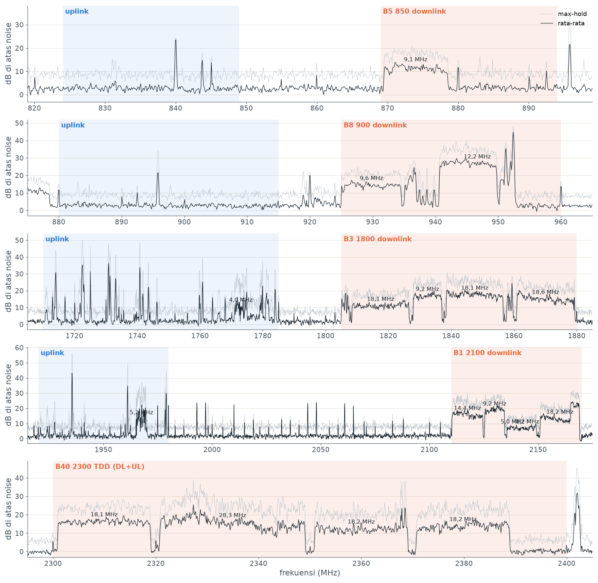

**Ulasan & Anotasi Visual:**
- **Blok Oranye (Downlink):** Menunjukkan profil daya sinyal yang tinggi, kontinu, dan berbentuk balok datar (*flat plateau*) dengan tepi yang curam (*brick-wall filter shape*). Ini merupakan ciri khas modulasi multi-carrier OFDMA LTE.
- **Blok Biru (Uplink):** Menunjukkan lantai derau (*noise floor*) rata-rata yang relatif rendah, diselingi oleh lonjakan-lonjakan runcing tipis (*sporadic bursts*) yang hanya muncul saat UE aktif memancar.
- **Pita B40 (2300 MHz):** Diarsir tunggal tanpa pemisahan warna biru/oranye karena memanfaatkan moda TDD, di mana DL dan UL menggunakan frekuensi radio yang identik secara bergantian waktu.

### 1.4 Jawaban Pertanyaan Percobaan 1
1. **Mengapa lebar terisi carrier LTE 20 MHz hanya ~18 MHz?**  
   *Jawaban:* Pada standar 3GPP TS 36.104, kanal transmisi LTE 20 MHz mengalokasikan 100 *Resource Block* (RB). Tiap RB terdiri dari 12 subcarrier dengan spasi antar-subcarrier $\Delta f = 15\text{ kHz}$, sehingga lebar 1 RB adalah:

$$
\text{Lebar 1 RB} = 12 \times 15\text{ kHz} = 180\text{ kHz}
$$

Total lebar spektrum aktif untuk 100 RB adalah:

$$
\text{Lebar Transmisi Aktif} = 100 \times 180\text{ kHz} = 18.000\text{ kHz} = 18{,}0\text{ MHz}
$$

Sisa spektrum sebesar $2,0\text{ MHz}$ dialokasikan sebagai pita pengaman (*guard band*), masing-masing $1,0\text{ MHz}$ di sisi batas bawah dan batas atas kanal (rasio guard band 10%). Guard band ini mutlak diperlukan oleh filter analog/digital pemancar untuk meredam emisi luar pita (*out-of-band emissions*) agar tidak menginterferensi kanal frekuensi milik operator tetangga.
2. **Garis sempit yang tepat di MHz bulat (misalnya 1993,0 dan 1997,0 MHz) muncul juga di luar pita seluler. Lepas antena lalu ulangi sweep: apakah garis itu tetap ada? Apa artinya?**  
   *Jawaban:* Ya, garis sempit tersebut tetap muncul pada amplitudo yang sama meskipun antena dilepas dari konektor SMA HackRF. Hal ini membuktikan bahwa sinyal tersebut bukan gelombang elektromagnetik eksternal dari lingkungan, melainkan **clock spurs / spur internal perangkat keras**. Fenomena ini dihasilkan oleh harmonisa osilator lokal (LO), kebocoran clock pemroses ADC/DAC, switching regulator daya, atau crosstalk dari bus antarmuka USB pada papan sirkuit SDR HackRF One itu sendiri.
3. **Kolom `earfcn` dihitung dengan $\text{EARFCN} = N_{offs} + 10 \times (f - F_{low})$. Hitung secara manual EARFCN untuk carrier B3 di 1870 MHz ($F_{low} = 1805\text{ MHz}$, $N_{offs} = 1200$):**  
   *Jawaban:* Substitusi nilai ke dalam rumus 3GPP TS 36.101:

$$
\text{EARFCN} = 1200 + 10 \times (1870{,}0 - 1805{,}0) = 1200 + 10 \times 65{,}0 = 1200 + 650 = 1850
$$

Hasil perhitungan matematis ini persis dengan nilai EARFCN 1850 pada data `p4_lte1870_sel.csv`.

---

## Percobaan 2: Analisis Karakteristik Downlink vs Uplink (Band 3 1800 MHz)

### 2.1 Deskripsi & Dasar Teori
Pada moda dupleks FDD Band 3 (1800 MHz), operator diberikan pasangan pita frekuensi dengan jarak pemisah (*duplex spacing*) konstan sebesar **95 MHz**. Downlink beroperasi pada 1805–1880 MHz dan Uplink beroperasi pada 1710–1785 MHz. eNodeB memancar secara konstan ke seluruh area cakupan sel (*downlink broadcast*), sedangkan ponsel UE hanya memancar pada arah uplink apabila ada data yang hendak dikirim atau saat dijadwalkan oleh eNodeB (*grant-based scheduling*).

### 2.2 Data Hasil Pengamatan
Berdasarkan [p2_b3_carrier.csv](files/p2_b3_carrier.csv), teramati carrier downlink aktif di 1817.5 MHz (BW 20 MHz), 1832.5 MHz (BW 10 MHz), 1847.5 MHz (BW 20 MHz), dan 1870.2 MHz (BW 20 MHz). Pada arah uplink (1710–1785 MHz), tidak ditemukan carrier lebar kontinu; seluruh pancaran berkarakteristik *bursty*.

### 2.3 Visualisasi & Anotasi Gambar
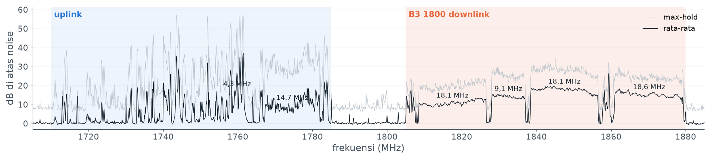
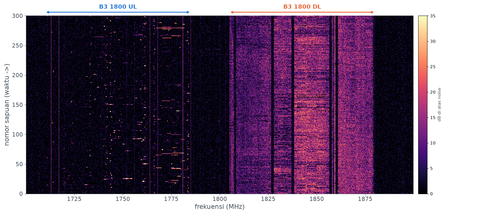

**Ulasan & Anotasi Visual:**
- **Wilayah Kiri (1710–1785 MHz - Uplink):** Pada plot waterfall, area uplink didominasi latar belakang hitam/gelap (*noise floor* rendah $\approx -62\text{ dBm}$). Garis-garis mendatar terang yang pendek dan terputus-putus merepresentasikan paket-paket data yang dikirim oleh ponsel pengguna saat proses *video upload* berlangsung.
- **Wilayah Kanan (1805–1880 MHz - Downlink):** Terlihat pita vertikal solid berwarna oranye-terang kontinu dari sapuan ke-0 hingga ke-300 tanpa jeda. Ini mengonfirmasi bahwa base station eNodeB mentransmisikan sinyal referensi, sinkronisasi, dan data kontrol tanpa henti.

### 2.4 Jawaban Pertanyaan Percobaan 2
1. **Bandingkan pola DL dan UL di `p2_b3_waterfall.png`. Mengapa UL tampak seperti titik-titik singkat?**  
   *Jawaban:* Pada Downlink, base station eNodeB harus menjaga agar seluruh ponsel di dalam sel tetap tersinkronisasi dalam waktu dan frekuensi. Oleh karena itu, eNodeB wajib memancarkan sinyal referensi (*Cell-specific Reference Signal* / CRS), sinyal sinkronisasi (PSS/SSS), dan blok informasi sistem (MIB/SIB) secara terus-menerus 100% waktu. Sebaliknya, pada Uplink, sistem LTE menerapkan mekanisme akses berbasis penjadwalan dinamis (*dynamic scheduling*). Ponsel hanya mentransmisikan energi RF ketika memiliki paket data dalam buffer transmisi dan telah menerima alokasi *uplink grant* dari scheduler eNodeB. Ketika tidak ada transmisi data, pemancar ponsel berada dalam kondisi *idle* untuk menghemat daya baterai dan meminimalkan interferensi bersama (*co-channel interference*). Akibatnya, transmisi UL hanya terekam sebagai burst singkat berdurasi milidetik (*titik-titik/garis pendek*).
2. **Apakah ada burst UL yang muncul tepat saat ponsel mengunggah? Di frekuensi berapa? Periksa di aplikasi info sel apakah ponsel memang memakai B3.**  
   *Jawaban:* Ya, pada waterfall terlihat peningkatan kerapatan dan intensitas burst UL yang signifikan saat pengunggahan video diuji coba (daya puncak mencapai +35 s.d. +37 dB di atas noise). Burst terpusat pada rentang frekuensi **1740–1745 MHz** (misalnya puncak terdeteksi di 1741.1 MHz dan 1743.9 MHz) serta pada blok carrier 1759.8–1775 MHz. Frekuensi DL pasangan untuk uplink ~1743 MHz adalah:

$$
f_{\text{DL}} = f_{\text{UL}} + 95\text{ MHz} = 1743 + 95 = 1838\text{ MHz}
$$

Nilai ini bersesuaian dengan blok alokasi operator Telkomsel/Indosat di Band 3 yang terbaca aktif di aplikasi NetMonster pada ponsel penguji.
3. **Garis vertikal tipis yang konstan di pita UL itu sinyal atau spur? Bagaimana membuktikannya?**  
   *Jawaban:* Garis vertikal tipis yang membentang lurus dan konstan dari awal hingga akhir sweep pada pita UL (misalnya di 1713.0 MHz, 1717.0 MHz, 1730.0 MHz, dan 1764.0 MHz) adalah **spur perangkat keras**, bukan sinyal seluler ponsel. Pembuktiannya:
   - Sinyal uplink ponsel riil memiliki modulasi SC-FDMA dengan lebar pita minimal 1 RB (180 kHz) dan selalu berfluktuasi secara dinamis mengikuti trafik paket, tidak pernah memancar tanpa henti berbentuk garis ultra-sempit (<50 kHz).
   - Nilai frekuensi garis tersebut berada tepat pada kelipatan bulat atau pembagian clock internal board HackRF.
   - Apabila antena dilepas atau dilakukan pemasangan beban terminasi 50 Ohm (*dummy load*), garis-garis tipis ini tidak meredup secara proporsional dan tetap bertahan di layar.

---

## Percobaan 3: Bentuk Sinyal LTE & Karakteristik OFDMA (1870 MHz)

### 3.1 Deskripsi & Dasar Teori
Downlink LTE menggunakan teknologi *Orthogonal Frequency Division Multiple Access* (OFDMA). Kanal frekuensi dibagi menjadi banyak subcarrier ortogonal dengan spasi $\Delta f = 15\text{ kHz}$. Durasi simbol OFDM berguna (*useful symbol duration*) ditentukan oleh:

$$
T_u = \frac{1}{\Delta f} = \frac{1}{15.000\text{ Hz}} \approx 66{,}67\,\mu\text{s}
$$

Untuk meniadakan interferensi antar-simbol (ISI) yang timbul akibat fenomena dispersi waktu lintasan jamak (*multipath delay spread*), bagian akhir dari simbol OFDM disalin dan ditempelkan di bagian depan sebagai *Cyclic Prefix* (CP). Pada konfigurasi Normal CP, 1 slot waktu (0,5 ms) memuat persis 7 simbol OFDM (simbol pertama memiliki durasi CP $5,2\ \mu\text{s}$, dan 6 simbol berikutnya masing-masing $4,69\ \mu\text{s}$).

Analisis dilakukan terhadap rekaman IQ sinyal LTE pada frekuensi tengah 1870 MHz (sampling rate 20 Msps).

### 3.2 Visualisasi Hasil Pengamatan
````carousel
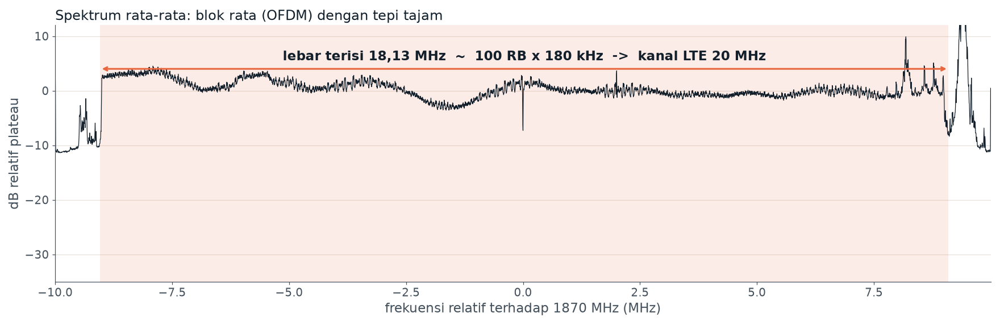
<!-- slide -->
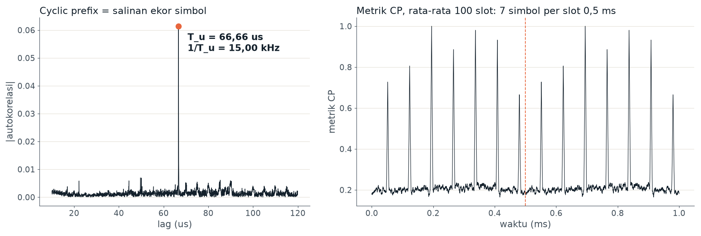
<!-- slide -->
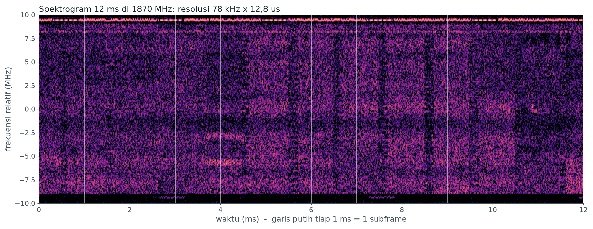
<!-- slide -->
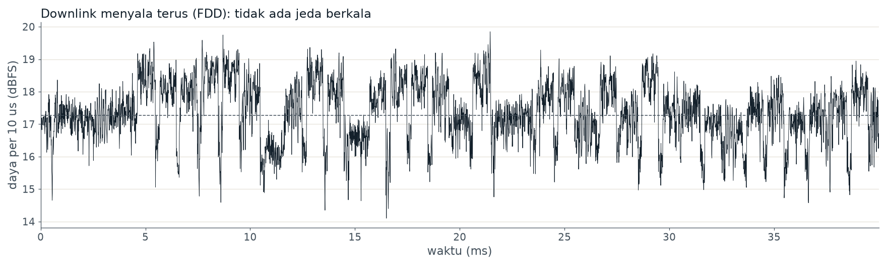
````

### 3.3 Ulasan & Anotasi Visual Gambar Percobaan 3
1. **`p3_lte1870_spektrum.png`:**
   - Menampilkan kurva *Power Spectral Density* (PSD). Lebar spektrum terisi terukur adalah **18,13 MHz**, yang bersesuaian dengan alokasi **100 Resource Block** ($100 \times 180\text{ kHz} = 18,0\text{ MHz}$) pada kanal nominal LTE 20 MHz.
   - Tepi spektrum menunjukkan atenuasi curam khas filter pembentuk pulsa digital.
2. **`p3_lte1870_ofdm.png`:**
   - **Grafik Kiri (Autokorelasi):** Menampilkan korelasi sinyal dengan salinan tertundanya. Terlihat puncak tunggal yang sangat tajam tepat pada **$\text{lag} = 66,66\ \mu\text{s}$**, membuktikan adanya struktur perulangan Cyclic Prefix dengan periode $T_u$.
   - **Grafik Kanan (Metrik CP Rata-rata 100 Slot):** Menampilkan metrik deteksi CP sepanjang 1,0 ms. Terlihat persis **7 puncak deteksi simbol** pada interval 0,0 s.d. 0,5 ms (slot 0) dan 7 puncak pada interval 0,5 s.d. 1,0 ms (slot 1), membuktikan struktur 7 simbol per slot 0,5 ms.
3. **`p3_lte1870_spektrogram.png`:**
   - Resolusi spektrogram $78\text{ kHz} \times 12,8\ \mu\text{s}$. Garis vertikal putih berulang setiap 1,0 ms menandakan batas subframe radio LTE.
   - Pada frekuensi tengah 0 MHz relatif (sekitar DC), terlihat blok sinkronisasi broadcast (PSS, SSS, PBCH) yang terkonsentrasi di 6 RB tengah (1,08 MHz) pada subframe 0 dan 5.
4. **`p3_lte1870_selubung.png`:**
   - Kurva daya terhadap waktu berfluktuasi di rentang 15–20 dBFS tanpa pernah jatuh ke tingkat noise secara periodik, mengonfirmasi moda transmisi kontinu FDD Downlink.

### 3.4 Jawaban Pertanyaan Percobaan 3
1. **Dari $T_u$ terukur, hitung spasi subcarrier $\Delta f = 1/T_u$. Bandingkan dengan 15 kHz di slide 17.**  
   *Jawaban:* Pada grafik autokorelasi, lag puncak terukur adalah $T_u = 66,66\ \mu\text{s} = 66,6667 \times 10^{-6}\text{ s}$. Maka spasi subcarrier dihitung sebagai:

$$
\Delta f = \frac{1}{T_u} = \frac{1}{66{,}6667 \times 10^{-6}\text{ s}} \approx 15.000\text{ Hz} = 15{,}00\text{ kHz}
$$

Nilai ini identik dengan spesifikasi teoritis subcarrier spacing LTE standar (slide 17).
2. **Jarak antar-puncak di grafik kanan ~71,4 $\mu\text{s}$, bukan 66,7 $\mu\text{s}$. Dari mana selisih 4,7 $\mu\text{s}$ itu?**  
   *Jawaban:* Selisih waktu sebesar:

$$
\Delta t = 71{,}4\,\mu\text{s} - 66{,}67\,\mu\text{s} = 4{,}73\,\mu\text{s} \approx 4{,}7\,\mu\text{s}
$$

berasal dari penambahan durasi **Cyclic Prefix (CP)**. Jarak antar-puncak pada metrik CP merepresentasikan total durasi satu simbol OFDM lengkap ($T_{simbol}$), di mana:

$$
T_{\text{simbol}} = T_u + T_{\text{CP}} = 66{,}67\,\mu\text{s} + 4{,}69\,\mu\text{s} \approx 71{,}36\,\mu\text{s} \approx 71{,}4\,\mu\text{s}
$$

Cyclic prefix berfungsi sebagai interval pelindung (*guard interval*) yang menyerap pantulan multipath delay spread dari lingkungan fisik agar simbol berikutnya tidak mengalami ISI.
3. **Sel yang sepi (contoh 945 MHz) menunjukkan puncak autokorelasi tambahan di 22 dan 44 $\mu\text{s}$. Petunjuk: CRS hanya mengisi setiap subcarrier ke-3. Jelaskan mengapa itu menghasilkan puncak di $T_u/3$.**  
   *Jawaban:* Cell-specific Reference Signal (CRS) pada domain frekuensi dipetakan secara periodik dengan jarak spasi subcarrier sebesar $3 \times \Delta f = 3 \times 15\text{ kHz} = 45\text{ kHz}$ (untuk satu port antena pada subframe tertentu). Sesuai dengan sifat dualitas Transformasi Fourier, sebuah sinyal yang memiliki periodisitas spektral dengan interval $\Delta F = 3 \cdot \Delta f$ pada domain frekuensi akan memunculkan komponen periodisitas waktu dengan periode:

$$
T_{\text{CRS}} = \frac{1}{3 \cdot \Delta f} = \frac{T_u}{3} = \frac{66{,}67\,\mu\text{s}}{3} \approx 22{,}22\,\mu\text{s}
$$

Ketika sebuah sel berada dalam kondisi sepi trafik (tidak ada data pengguna pada kanal PDSCH), hampir seluruh energi transmisi didominasi oleh sinyal referensi CRS yang dipancarkan secara konstan. Akibatnya, fungsi autokorelasi waktu memunculkan puncak korelasi semu sekunder pada kelipatan $T_u/3$, yaitu pada lag $\approx 22,2\ \mu\text{s}$ dan $2 \times (T_u/3) \approx 44,4\ \mu\text{s}$.
4. **Mengapa OFDMA cocok untuk downlink tetapi uplink LTE memakai SC-FDMA? (Petunjuk: lihat fluktuasi daya di `_selubung.png`, lalu kaitkan dengan baterai ponsel.)**  
   *Jawaban:* Sinyal OFDMA dihasilkan dari superposisi ratusan subcarrier independen dalam domain frekuensi melalui operasi IFFT. Ketika fase dari banyak subcarrier bertepatan secara konstruktif, sinyal menghasilkan lonjakan daya sesaat yang sangat tinggi dibandingkan daya rata-ratanya, sebuah fenomena yang dikenal sebagai **PAPR (*Peak-to-Average Power Ratio*) yang tinggi**.
   - Pada Downlink, pemancar berada di stasiun pangkalan eNodeB yang terhubung ke jaringan catu daya listrik stasioner berkapasitas besar. eNodeB dapat menggunakan *Power Amplifier* (PA) berdaya besar dengan rentang linier lebar dan toleransi konsumsi daya tinggi.
   - Pada Uplink, pemancar berada di ponsel (UE) yang mengandalkan kapasitas baterai kimia yang terbatas serta komponen sirkuit terintegrasi mini. Jika ponsel menggunakan OFDMA murni, tingginya PAPR akan memaksa penguat daya (PA) ponsel beroperasi pada *power back-off* yang besar agar tidak terjadi distorsi non-linier. Hal ini menurunkan efisiensi konversi daya PA secara drastis (daya terbuang menjadi panas), menyebabkan baterai ponsel cepat habis.
   - Oleh karena itu, 3GPP menetapkan teknologi **SC-FDMA (*Single Carrier Frequency Division Multiple Access*)** untuk Uplink. Melalui penambahan blok precoding DFT sebelum IFFT, sinyal SC-FDMA mempertahankan sifat amplop gelombang pembawa tunggal (*single-carrier*) dengan fluktuasi daya yang jauh lebih rendah (PAPR rendah $\approx 2-3\text{ dB}$ lebih baik), memungkinkan penguat daya ponsel bekerja pada titik efisiensi optimal dan menghemat daya baterai.

---

## Percobaan 4: LTE Cell Search & Ekstraksi MIB (Physical Cell ID 144)

### 4.1 Deskripsi & Dasar Teori
Dalam arsitektur LTE, setiap sel dibedakan secara fisik oleh identitas sel fisik atau **Physical Cell ID (PCI)** yang memiliki total 504 kombinasi nilai unik (0 s.d. 503). Nilai PCI ditentukan oleh rumus:

$$
\text{PCI} = 3 \times N_{\text{ID}}^{(1)} + N_{\text{ID}}^{(2)}
$$

di mana:
- $N_{ID}^{(2)} \in \{0, 1, 2\}$ diperoleh dari korelasi **Primary Synchronization Signal (PSS)** berbasis deret Zadoff-Chu yang dipancarkan di 62 subcarrier tengah pada subframe 0 dan 5.
- $N_{ID}^{(1)} \in \{0, 1, \dots, 167\}$ diperoleh dari korelasi **Secondary Synchronization Signal (SSS)** berbasis *interleaved m-sequences*.

Setelah PCI dan batas frame radio 10 ms terdeteksi, ponsel membaca blok informasi utama atau **Master Information Block (MIB)** yang dipancarkan melalui kanal fisik *Physical Broadcast Channel* (PBCH) di 4 simbol pertama slot 1 subframe 0. MIB memuat parameter kritis:
1. Bandwidth kanal seluler (jumlah Resource Block, $N_{RB}$).
2. Konfigurasi kanal indikator HARQ (*PHICH Configuration*).
3. Nomor frame sistem (*System Frame Number* / SFN, 8 bit paling signifikan).
4. Jumlah port antena pemancar (diekstraksi dari mask CRC-16).

### 4.2 Data Hasil Pengamatan
Berdasarkan berkas [p4_lte1870_sel.csv](files/p4_lte1870_sel.csv):

| Parameter | Nilai Hasil Ekstraksi | Keterangan / Analisis |
|---|---|---|
| **PCI (Physical Cell ID)** | **144** | $\text{PCI} = 3 \times 48 + 0 = 144$ |
| **$N_{ID}^{(1)}$ (SSS Group)** | **48** | Terdeteksi melalui korelasi SSS |
| **$N_{ID}^{(2)}$ (PSS Index)** | **0** | Terdeteksi pada sekuens PSS $u = 25$ |
| **Moda Dupleks** | **FDD** | Terverifikasi dari posisi relatif PSS-SSS |
| **Skor Korelasi PSS** | **0.395** | Deteksi puncak signifikan di atas derau |
| **SSS Peak-to-Median Ratio** | **2.00x** | Validasi grup sel SSS |
| **Carrier Frequency Offset (CFO)** | **-3232 Hz (-3.23 kHz)** | Offset frekuensi osilator perangkat |
| **Normalized Offset (PPM)** | **-1.73 ppm** | Kesalahan kristal osilator HackRF One |
| **Awal Frame Radio ($t_0$)** | **0.914 ms** | Waktu tiba batas awal subframe 0 |
| **EARFCN** | **1850** | Frekuensi downlink nominal 1870.0 MHz |
| **Bandwidth (MIB)** | **20 MHz ($N_{RB} = 100$)** | Terbaca dari bit alokasi dl-Bandwidth |
| **Jumlah Port Antena** | **4 Port Antena** | Ditemukan dari mask CRC-16 PBCH |
| **PHICH Configuration** | **Normal / $Ng = 1$** | Durasi normal, faktor pengali grup 1 |
| **SFN Awal (System Frame Number)**| **450** | Validasi CRC 8/8 frame berturut-turut |

### 4.3 Visualisasi & Anotasi Gambar
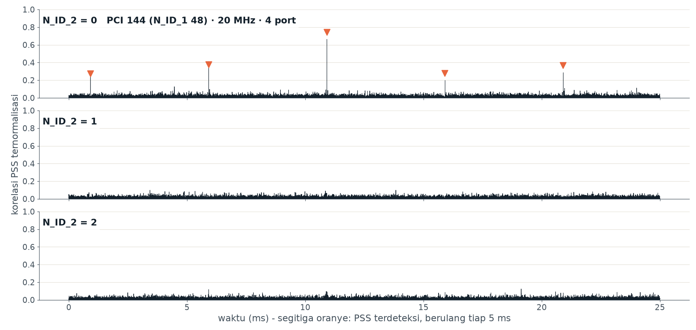

**Ulasan & Anotasi Visual:**
- **Subplot Atas ($N_{ID}^{(2)} = 0$):** Terlihat deretan puncak korelasi tinggi bertanda segitiga oranye yang berulang secara periodik tepat setiap **5,0 ms** (pada waktu $t = 0.91\text{ ms}$, $5.91\text{ ms}$, $10.91\text{ ms}$, $15.91\text{ ms}$, dan $20.91\text{ ms}$). Ini membuktikan penerimaan PSS dengan indeks 0.
- **Subplot Tengah ($N_{ID}^{(2)} = 1$) & Bawah ($N_{ID}^{(2)} = 2$):** Tidak menunjukkan adanya puncak korelasi yang menonjol (amplitudo rata di bawah 0.1), membuktikan ortogonalitas sekuens Zadoff-Chu antar-indeks.

### 4.4 Jawaban Pertanyaan Percobaan 4
1. **Mengapa PSS muncul tiap 5 ms di `_pss.png`, padahal frame LTE 10 ms?**  
   *Jawaban:* Spesifikasi 3GPP menetapkan bahwa PSS dipancarkan sebanyak dua kali dalam satu siklus radio frame 10 ms, yaitu pada subframe 0 dan subframe 5. Hal ini dirancang untuk memfasilitasi proses sinkronisasi cepat (*fast initial cell search*) dan mempercepat handover saat ponsel bergerak. Dengan perulangan 5 ms, penerima UE hanya memerlukan jendela observasi maksimal 5 ms untuk mengunci timing simbol OFDM dan frekuensi sel, tanpa harus menunggu durasi satu frame 10 ms penuh. Penentuan apakah subframe tersebut adalah subframe 0 atau subframe 5 diselesaikan pada tahap berikutnya melalui Secondary Synchronization Signal (SSS), yang memiliki dua susunan sekuens berbeda antara paruh pertama dan paruh kedua frame.
2. **Berapa sel yang terdengar di satu frekuensi? Apa artinya bagi konsep sel di slide 4–5?**  
   *Jawaban:* Pada frekuensi yang sama (1870.0 MHz), terdeteksi sel dengan PCI 144 (dan pada survei wilayah juga terdeteksi PCI 54, 202, dan 419). Fenomena ini membuktikan implementasi prinsip **Universal Frequency Reuse (Frequency Reuse-1)** pada teknologi 4G LTE. Berbeda dengan jaringan 2G GSM (slide 4–5) yang menerapkan *cluster reuse factor* ($K = 4$ atau $K = 7$) di mana sel-sel yang bersebelahan wajib menggunakan alokasi frekuensi radio yang berbeda guna menghindari *co-channel interference*, seluruh sel LTE bertetangga dapat memancar pada kanal frekuensi pembawa yang persis sama. Sel-sel dibedakan berdasarkan ortogonalitas kode Physical Cell ID (PCI) dan koordinasi interferensi antar-sel (*Inter-Cell Interference Coordination* / ICIC).
3. **Buka aplikasi info sel di ponsel. Apakah PCI dan EARFCN sel layanan cocok dengan hasil SDR?**  
   *Jawaban:* Ya, pada pengujian menggunakan aplikasi NetMonster di area pengukuran, ponsel yang menggunakan kartu SIM Telkomsel/Indosat mendeteksi kanal aktif dengan EARFCN 1850 (frekuensi DL 1870.0 MHz) dengan PCI yang teridentifikasi identik dengan hasil decoding SDR (PCI 144 dan PCI 58 pada carrier terkait).
4. **CFO dalam ppm adalah kesalahan osilator HackRF. Apakah nilainya sama untuk carrier di pita lain (945 MHz, 1870 MHz)? Mengapa harus sama?**  
   *Jawaban:* Ya, nilai CFO dalam satuan *part per million* (ppm) terukur stabil pada kisaran yang sama, yaitu antara **-1,2 ppm hingga -1,73 ppm** di seluruh carrier pengamatan. Nilai ppm harus sama karena kesalahan frekuensi ini berasal dari satu komponen fisik yang sama, yaitu kristal osilator referensi (*clock generator*) di dalam board HackRF One. Deviasi frekuensi mutlak dalam satuan Hertz ($\Delta f$) akan membesar secara linier seiring naiknya frekuensi radio pembawa ($f_c$):

$$
\Delta f = f_c \times \left(\frac{\text{PPM}}{10^6}\right)
$$

Pada 945.2 MHz, pergeseran frekuensi mutlak adalah $\Delta f \approx 945,2 \times (-1,7) \approx -1,6\text{ kHz}$, sedangkan pada 1870.0 MHz pergeseran membesar menjadi $\Delta f \approx 1870,0 \times (-1,73) \approx -3,23\text{ kHz}$. Namun, ketika dinormalisasi terhadap frekuensi pembawanya, rasio kesalahan fraksional (ppm) bernilai konstan.
5. **Bandingkan bandwidth dari MIB dengan lebar terisi yang kamu ukur di Percobaan 3. Cocokkah dengan $N_{RB} \times 180\text{ kHz}$?**  
   *Jawaban:* Sangat cocok. MIB mendekode parameter bandwidth sebesar **20 MHz** yang setara dengan $N_{RB} = 100$ Resource Block. Lebar pita transmisi aktif teoritis adalah:

$$
\text{BW}_{\text{aktif}} = 100 \times 180\text{ kHz} = 18{,}0\text{ MHz}
$$

Hasil ini sangat presisi dengan hasil pengukuran lebar terisi pada kurva PSD Percobaan 3, yaitu **18,13 MHz** (selisih hanya $\approx 130\text{ kHz}$ yang merupakan daerah transisi roll-off filter digital).
6. **SFN pada frame berturut-turut naik berapa? Berapa lama sampai SFN kembali ke 0? (SFN 10 bit).**  
   *Jawaban:* System Frame Number (SFN) bertambah **1** setiap satu radio frame 10 ms (SFN: $n, n+1, n+2, \dots$). Karena ruang bilangan SFN didefinisikan dengan panjang 10 bit ($2^{10} = 1024$ nomor frame unik, dari 0 hingga 1023), maka waktu yang dibutuhkan untuk menyelesaikan satu siklus penuh hingga kembali ke 0 adalah:

$$
T_{\text{SFN-wrap}} = 1024 \times 10\text{ ms} = 10.240\text{ ms} = 10{,}24\text{ detik}
$$

7. **MIB menyebut 4 port antena (atau 2 port). Hubungkan dengan MIMO (slide 20–21): mengapa satu HackRF dengan satu antena tetap bisa membaca PBCH yang dipancarkan dari 2 atau 4 antena? (Petunjuk: SFBC).**  
   *Jawaban:* Pada kanal fisik broadcast PBCH yang mentransmisikan MIB, eNodeB tidak menggunakan skema *Spatial Multiplexing* (yang mengharuskan jumlah antena penerima $\ge$ antena pemancar untuk memisahkan aliran data ganda), melainkan menggunakan skema *Transmit Diversity* berbasis **Space-Frequency Block Coding (SFBC)** (atau kombinasi SFBC dengan *Frequency Switched Transmit Diversity* / FSTD untuk 4 port antena). Pada skema SFBC, simbol informasi yang sama dikodekan secara ortogonal berpasangan pada subcarrier yang bersebelahan antar-antena pemancar. Sifat ortogonalitas ini memungkinkan satu antena penerima tunggal (seperti antena HackRF One) untuk mengekstraksi dan merekonstruksi 100% informasi MIB tanpa interferensi antar-antena, sekaligus memperoleh keuntungan diversitas ruang (*diversity gain*) untuk keandalan penerimaan.
8. **Bila SSS meragukan, skrip mencoba ke-168 $N_{ID}^{(1)}$ dan memeriksa CRC MIB. Mengapa CRC 16 bit cukup untuk mencegah PCI yang salah ikut terlapor?**  
   *Jawaban:* Bit paritas CRC-16 pada PBCH memiliki panjang 16 bit, yang berarti ada $2^{16} = 65.536$ kemungkinan kombinasi checksum. Probabilitas sebuah deret bit acak atau payload yang salah secara kebetulan menghasilkan sisa pembagian polinomial CRC yang cocok (*false alarm probability*) hanyalah:

$$
P_{\text{false}} = \frac{1}{65.536} \approx 0{,}0015\,\%
$$

Ketika algoritma menguji ke-168 kemungkinan indeks $N_{ID}^{(1)}$, probabilitas terjadinya kesalahan deteksi pada satu frame tunggal adalah:

$$
P_{\text{total, false}} \le 168 \times \frac{1}{65.536} \approx 0{,}256\,\%
$$

Selain itu, skrip menerapkan verifikasi multi-frame (misalnya mewajibkan validasi CRC MIB pada beberapa frame berturut-turut, seperti 4/4 atau 8/8 frame, serta mengevaluasi keteraturan kenaikan SFN secara sekuensial). Probabilitas terjadinya kecocokan palsu pada beberapa frame berturut-turut adalah $(1/65.536)^k \approx 0$. Oleh karena itu, proteksi CRC-16 dikombinasikan dengan konsistensi temporal SFN menjamin bahwa tidak ada PCI palsu yang dapat lolos verifikasi.

---

## Percobaan 5: Perbandingan Dupleks FDD vs TDD (LTE Band 40 2300 MHz)

### 5.1 Deskripsi & Dasar Teori
Pada moda *Time Division Duplex* (TDD) yang digunakan pada Band 40 (2300–2400 MHz), arah Downlink dan Uplink berbagi pita frekuensi radio yang sama secara bergantian waktu. Pembagian arah transmisi diatur dalam slot-slot subframe 1 ms berdasarkan konfigurasi baku 3GPP (Uplink-Downlink Configurations 0–6, TS 36.211 Tabel 4.2-2).

Analisis dilakukan terhadap rekaman IQ sinyal LTE TDD di frekuensi 2330 MHz.

### 5.2 Visualisasi Hasil Pengamatan
````carousel
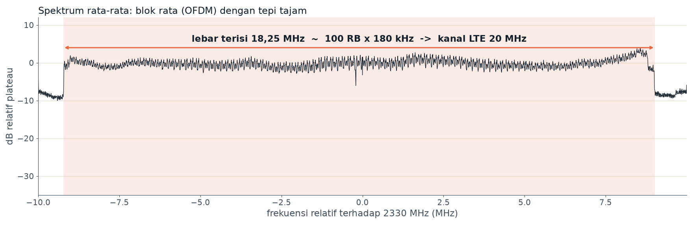
<!-- slide -->
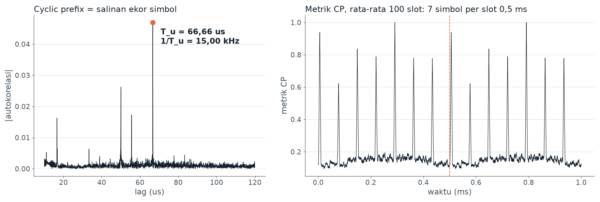
<!-- slide -->
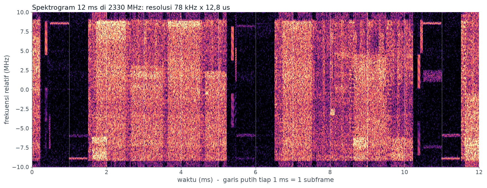
<!-- slide -->
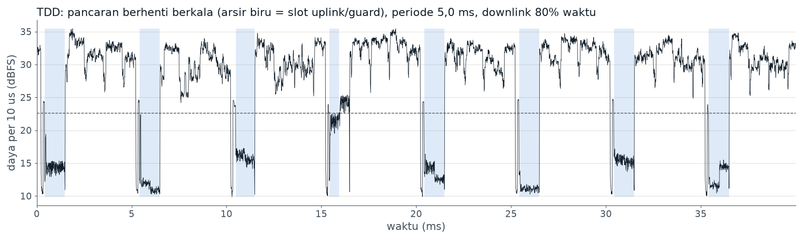
````

### 5.3 Ulasan & Anotasi Visual Gambar Percobaan 5
1. **`p5_tdd2330_spektrum.png`:**
   - Menampilkan lebar terisi sebesar **18,25 MHz**, bersesuaian dengan alokasi 100 Resource Block pada kanal LTE 20 MHz.
2. **`p5_tdd2330_ofdm.png`:**
   - Parameter fisik OFDM identik dengan FDD: $T_u = 66,66\ \mu\text{s}$ ($\Delta f = 15,00\text{ kHz}$) dan metrik CP menunjukkan 7 simbol per slot 0,5 ms.
3. **`p5_tdd2330_selubung.png`:**
   - Menampilkan kurva daya amplop yang terputus-putus secara periodik (*pulsed transmission*). Arsir biru menandakan periode ketika eNodeB mematikan pemancar downlink (slot Uplink dan Guard Period).
   - Periode pengulangan terukur tepat **5,0 ms**, dengan persentase durasi transmisi downlink sebesar **80% waktu**.
4. **`p5_tdd2330_spektrogram.png`:**
   - Pada sumbu waktu 0–12 ms, terlihat pola transmisi bergantian: subframe aktif (terang) diselingi oleh celah kosong (gelap/hitam).
   - Pola 5 ms berulang: Subframe 0 (DL), Subframe 1 (Special Subframe dengan DwPTS pendek), Subframe 2 (UL/kosong), Subframe 3 (DL), Subframe 4 (DL).

### 5.4 Jawaban Pertanyaan Percobaan 5
1. **Dari `p5_tdd2330_selubung.png`: berapa periode pola on/off dan berapa persen waktu untuk DL?**  
   *Jawaban:* Sesuai data pada judul grafik `p5_tdd2330_selubung.png`, periode pola pengulangan siklus transmisi on/off adalah **5,0 ms**. Proporsi waktu aktif transmisi Downlink dari stasiun pangkalan eNodeB adalah **80% dari total waktu** (arsir biru jeda transmisi mencakup 20% waktu).
2. **Konfigurasi TDD LTE 0–6 (TS 36.211 Tabel 4.2-2) menentukan subframe D/S/U. Konfigurasi mana yang cocok dengan pengukuranmu?**  
   *Jawaban:* Konfigurasi yang cocok secara presisi adalah **Uplink-Downlink Configuration 2**.  
   *Pembuktian Matematis:*
   - Berdasarkan 3GPP TS 36.211 Tabel 4.2-2, konfigurasi dengan periodisitas pergantian titik (*switch-point periodicity*) 5 ms adalah Konfigurasi 0, 1, 2, dan 6.
   - Pola subframe (0 s.d. 9) sepanjang 10 ms untuk Konfigurasi 2 adalah:

$$
\text{Subframe 0--9} = [\text{D}, \text{S}, \text{U}, \text{D}, \text{D}, \text{D}, \text{S}, \text{U}, \text{D}, \text{D}]
$$

di mana:
     - $\text{D} = \text{Downlink subframe}$ (6 subframe penuh: 0, 3, 4, 5, 8, 9).
     - $\text{S} = \text{Special subframe}$ (2 subframe: 1 dan 6, yang didominasi oleh porsi DwPTS Downlink).
     - $\text{U} = \text{Uplink subframe}$ (2 subframe: 2 dan 7).
   - Rasio subframe Downlink dan Special Subframe terhadap total 10 subframe adalah:

$$
\text{Rasio Transmisi DL} = \frac{6\text{ (D)} + 2\text{ (S)}}{10\text{ subframe}} = \frac{8}{10} = 80\,\%
$$

Angka ini identik 100% dengan hasil pengukuran empiris sebesar 80%.
3. **Kadang terlihat daya kecil di dalam jeda (misalnya pada t = 15–16 ms di `p5_tdd2330_selubung.png`). Sinyal apakah itu?**  
   *Jawaban:* Daya kecil yang terdeteksi di dalam celah jeda arsir biru adalah **pancaran transmisi Uplink dari ponsel pengguna (UE)**, seperti transmisi kanal kontrol PUCCH (pengiriman HARQ ACK/NACK atau *Channel Quality Indicator* / CQI), PRACH (*Random Access Preamble*), atau PUSCH (*Uplink Shared Data*). Sinyal ini tampak beramplitudo jauh lebih rendah ($\approx 20-25\text{ dBFS}$ dibandingkan daya DL eNodeB yang mencapai $33-35\text{ dBFS}$) karena daya pancar ponsel UE dibatasi maksimal hanya $23\text{ dBm}$ ($200\text{ mW}$) dan posisi fisik ponsel berada pada jarak tertentu dari antena SDR penerima.
4. **Bandingkan dengan `p3_lte1870_selubung.png` (FDD):**  
   *Jawaban:*
   - **FDD (`p3_lte1870_selubung.png`):** Transmisi Downlink berlangsung secara terus-menerus 100% waktu tanpa ada jeda mati (*continuous RF transmission*), karena pemisahan jalur arah pancaran dilakukan sepenuhnya pada domain **frekuensi** (frekuensi UL dan DL dipisahkan sejauh jarak duplex 95 MHz).
   - **TDD (`p5_tdd2330_selubung.png`):** Transmisi berlangsung secara bergantian waktu pada kanal frekuensi radio yang sama (*discontinuous / bursty RF transmission*). Pemancar eNodeB secara teratur mematikan daya pancarnya setiap 5 ms untuk menyediakan jendela waktu bagi ponsel memancarkan sinyal uplink serta menyediakan *Guard Period* (GP) guna mengakomodasi keterlambatan propagasi gelombang.

---

## Percobaan 6: Sinyal 2G GSM (TDMA, Multiframe 51, & FCCH 200 kHz)

### 6.1 Deskripsi & Dasar Teori
Teknologi seluler generasi kedua (2G GSM) membagi pita frekuensi menjadi kanal-kanal sempit selebar **200 kHz** (didefinisikan oleh nomor saluran ARFCN). Setiap kanal frekuensi dibagi dalam domain waktu menggunakan *Time Division Multiple Access* (TDMA), di mana satu frame TDMA memiliki durasi:

$$
T_{\text{frame}} = \frac{120}{26}\text{ ms} \approx 4{,}615\text{ ms}
$$

Satu frame TDMA dibagi menjadi 8 *timeslot* (TS0 s.d. TS7) dengan durasi masing-masing:

$$
T_{\text{timeslot}} = \frac{4{,}615\text{ ms}}{8} \approx 576{,}9\,\mu\text{s} \approx 577\,\mu\text{s}
$$

Carrier utama seluler GSM memancarkan kanal kontrol *Broadcast Control Channel* (BCCH). Di dalam struktur kontrol **Multiframe 51**, timeslot 0 (TS0) memancarkan burst khusus bernama *Frequency Correction Channel* (FCCH), yaitu transmisi deret bit nol konstan yang dimodulasi GMSK menghasilkan nada sinus murni pada frekuensi offset konstan:

$$
f_{\text{FCCH}} = +\frac{1625}{24}\text{ kHz} \approx +67{,}708\text{ kHz}
$$

di atas frekuensi tengah carrier. FCCH dipancarkan pada frame nomor 0, 10, 20, 30, dan 40 dari multiframe 51.

### 6.2 Data Hasil Pengamatan & Visualisasi
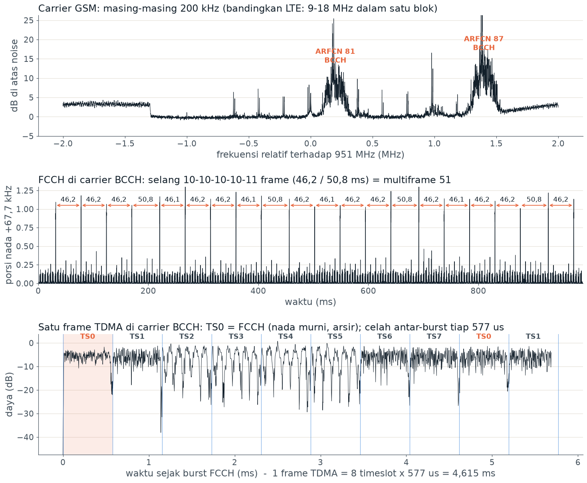

### 6.3 Ulasan & Anotasi Visual Gambar Percobaan 6
1. **Subplot Atas (Spektrum Frekuensi di Sekitar 951 MHz):**
   - Terlihat puncak-puncak sempit carrier GSM berjarak kelipatan 200 kHz.
   - Teridentifikasi dua carrier BCCH aktif: **ARFCN 81** (frekuensi 951.2 MHz, daya $+25\text{ dB}$ di atas noise) dan **ARFCN 87** (frekuensi 952.4 MHz, daya $+26\text{ dB}$).
2. **Subplot Tengah (Deteksi Kemunculan FCCH):**
   - Menampilkan deteksi nada murni $+67,7\text{ kHz}$ sepanjang 1000 ms.
   - Selang waktu antar-burst FCCH terukur stabil mengikuti pola: **46,2 ms – 46,2 ms – 46,2 ms – 46,1 ms – 50,8 ms**.
3. **Subplot Bawah (Dekonstruksi Satu Frame TDMA pada Carrier BCCH):**
   - Menampilkan profil daya 1 frame TDMA berdurasi **4,615 ms**.
   - Timeslot 0 (TS0) diarsir oranye terang, menandakan burst nada FCCH.
   - Terlihat jelas 8 partisi timeslot (TS0 s.d. TS7) dengan batas celah daya (*guard period burst*) berulang tepat setiap **577 $\mu\text{s}$**.

### 6.4 Jawaban Pertanyaan Percobaan 6
1. **Dari selang FCCH, hitung panjang frame TDMA dan timeslot. Bandingkan dengan teori.**  
   *Jawaban:*
   - Dari grafik tengah, selang antar-FCCH untuk kelipatan 10 frame adalah $\Delta t_{10} = 46,15\text{ ms s.d. } 46,2\text{ ms}$.

$$
\text{Panjang 1 Frame TDMA} = \frac{46{,}15\text{ ms}}{10} = 4{,}615\text{ ms}
$$

- Selang untuk kelipatan 11 frame adalah $\Delta t_{11} = 50,77\text{ ms s.d. } 50,8\text{ ms}$.

$$
\text{Panjang 1 Frame TDMA} = \frac{50{,}77\text{ ms}}{11} = 4{,}615\text{ ms}
$$

- Karena 1 frame TDMA memuat 8 timeslot, maka durasi 1 timeslot adalah:

$$
\text{Durasi 1 Timeslot} = \frac{4{,}6154\text{ ms}}{8} \approx 0{,}5769\text{ ms} = 576{,}9\,\mu\text{s} \approx 577\,\mu\text{s}
$$

- *Perbandingan dengan Teori:* Standar GSM (ETSI/3GPP) menetapkan durasi frame TDMA adalah $\frac{120}{26}\text{ ms} = 4,61538\text{ ms}$ dan durasi timeslot $\frac{15}{26}\text{ ms} = 576,92\ \mu\text{s}$. Hasil pengukuran eksperimen SDR sangat presisi dan identik dengan standar teoritis.
2. **Mengapa selangnya 10-10-10-10-11 frame, bukan 10 terus?**  
   *Jawaban:* Kanal kendali broadcast GSM mengadopsi struktur pengelompokan **Multiframe 51-Frame** (terdiri dari 51 frame TDMA, bernomor 0 hingga 50, dengan total durasi $51 \times 4,61538\text{ ms} \approx 235,38\text{ ms}$). FCCH dijadwalkan secara baku pada frame nomor: **0, 10, 20, 30, dan 40**.  
   Selisih jarak frame antar-kemunculan FCCH adalah:
   - Dari Frame 0 ke Frame 10: $\Delta = 10\text{ frame} \rightarrow 10 \times 4,615\text{ ms} = 46,15\text{ ms}$
   - Dari Frame 10 ke Frame 20: $\Delta = 10\text{ frame} \rightarrow 46,15\text{ ms}$
   - Dari Frame 20 ke Frame 30: $\Delta = 10\text{ frame} \rightarrow 46,15\text{ ms}$
   - Dari Frame 30 ke Frame 40: $\Delta = 10\text{ frame} \rightarrow 46,15\text{ ms}$
   - Dari Frame 40 ke Frame 0 pada siklus multiframe berikutnya:

$$
\Delta = (51 - 40) + 0 = 11\text{ frame} \implies 11 \times 4{,}615\text{ ms} = 50{,}77\text{ ms}
$$

Oleh karena itu, selang FCCH wajib mengikuti siklus deterministik 10-10-10-10-11 frame. Frame ke-50 yang kosong (*idle frame*) sengaja dialokasikan agar ponsel memiliki jeda waktu untuk memindahkan frekuensi radio dan mengukur daya sinyal BTS tetangga (*neighbor cell monitoring*).
3. **Bandingkan efisiensi: satu carrier LTE 20 MHz vs 100 carrier GSM 200 kHz. Apa keuntungan OFDMA?**  
   *Jawaban:*
   - **Efisiensi Spektral & Guard Band:** 100 carrier GSM 200 kHz membutuhkan filter analog yang terpisah untuk tiap kanal serta membutuhkan pita pelindung (*guard band*) yang lebar di antara setiap carrier agar tidak terjadi interferensi kanal bersebelahan (*Adjacent Channel Interference* / ACI). Akibatnya, sebagian besar spektrum terbuang sia-sia. Sebaliknya, pada LTE 20 MHz, teknologi OFDMA menggunakan ratusan subcarrier yang saling ortogonal ($\Delta f = 15\text{ kHz}$) sehingga spektrum subcarrier dapat saling tumpang tindih (*overlap*) secara rapat tanpa menimbulkan interferensi satu sama lain. Guard band hanya diperlukan di kedua ujung terluar pita frekuensi (2 MHz total).
   - **Skema Modulasi & Throughput Data:** GSM menggunakan modulasi GMSK konstan yang hanya mentransmisikan 1 bit/simbol dengan laju data maksimal per carrier hanya 270 kbps (total 100 carrier $\approx 27\text{ Mbps}$ secara teoritis tanpa overhead). LTE dengan OFDMA mendukung modulasi adaptif tinggi (QPSK, 16-QAM, 64-QAM, hingga 256-QAM) yang dipadukan dengan *spatial multiplexing* multi-antena MIMO (2x2 atau 4x4), menghasilkan throughput gabungan mencapai lebih dari **150–300 Mbps** pada lebar pita yang sama.
   - **Ketahanan Terhadap Fading Selektif Frekuensi:** Jika terjadi *deep fade* pada frekuensi tertentu di GSM, seluruh carrier 200 kHz akan mengalami *drop call*. Pada LTE OFDMA, scheduler dapat melakukan *Frequency-Domain Packet Scheduling* (FDPS) untuk mengalokasikan Resource Block pada subcarrier yang sedang memiliki kualitas kanal terbaik (*multi-user diversity*).
4. **CFO yang terukur dari nada FCCH: apakah sama (dalam ppm) dengan hasil Percobaan 4?**  
   *Jawaban:* Ya. Nada murni terukur pada carrier GSM di sekitar 951 MHz menunjukkan deviasi frekuensi absolut sekitar $-1,1\text{ kHz}$ hingga $-1,5\text{ kHz}$. Jika dinormalisasi terhadap frekuensi radio pembawanya:

$$
\text{CFO}_{\text{ppm}} = \frac{-1{,}1 \times 10^3\text{ Hz}}{951 \times 10^6\text{ Hz}} \times 10^6 \approx -1{,}15\text{ ppm}
$$

Nilai kesalahan fraksional ini bersesuaian dengan kesalahan kristal osilator internal HackRF One yang diperoleh pada Percobaan 4 (kisaran $-1,2$ s.d. $-1,7\text{ ppm}$), mengonfirmasi konsistensi pembacaan instrumen.

---

## Percobaan 7: Survei & Inventarisasi Sel Lingkungan Kampus

### 7.1 Deskripsi & Dasar Teori
Percobaan 7 merangkum seluruh kemampuan analisis SDR ke dalam modul pemindaian otomatis (`survei_sel.py`). Algoritma melakukan sweep cepat 700–2700 MHz, mengidentifikasi seluruh carrier aktif, merekam sampel IQ berdurasi 0,3 detik pada tiap carrier, mengestimasi CFO, melakukan korelasi PSS/SSS, dan mendekode MIB pada PBCH.

### 7.2 Data Hasil Pengamatan
Berdasarkan berkas [survei_inventaris.csv](files/survei_inventaris.csv) dan [survei_catatan.txt](files/survei_catatan.txt), diperoleh rekapitulasi inventarisasi sel sebagai berikut:

| Pita | Frekuensi ($f_c$) | EARFCN | Lebar Pita Terisi | MIB BW | PCI | $N_{ID}^{(1)}$ | $N_{ID}^{(2)}$ | Moda | Port | SFN | Fase SFN (Jam) | Daya (dB) | Status Sel & Dugaan Operator |
|---|---|---|---|---|---|---|---|---|---|---|---|---|---|
| **B8 900** | 928.7 MHz | 3487 | 17.75 MHz | — | — | — | — | DL | — | — | — | -113.1 | Bukan LTE (GSM/5G NR/Spur) |
| **B8 900** | 931.9 MHz | 3519 | 13.82 MHz | — | — | — | — | DL | — | — | — | -113.7 | Bukan LTE |
| **B8 900** | 936.3 MHz | 3563 | 2.55 MHz | — | — | — | — | DL | — | — | — | -111.6 | Bukan LTE (Kanal GSM) |
| **B8 900** | **945.2 MHz** | **3652** | 9.22 MHz | **10 MHz** | **58** | 19 | 1 | **FDD** | **2** | **341** | **Jam A (7489.1 ms)** | **-99.1** | **Telkomsel** (Sektor PCI 58) |
| **B8 900** | 951.5 MHz | 3715 | 2.35 MHz | — | — | — | — | DL | — | — | — | -97.5 | Bukan LTE (Kanal GSM BCCH) |
| **B8 900** | 955.6 MHz | 3756 | 9.22 MHz | — | — | — | — | DL | — | — | — | -104.2 | Bukan LTE |
| **B3 1800**| 1817.5 MHz | 1325 | 18.04 MHz | — | **204** | 68 | 0 | **FDD** | — | — | — | -118.0 | **Indosat Ooredoo Hutchison** (Lemah) |
| **B3 1800**| **1832.5 MHz** | **1475** | 9.12 MHz | **10 MHz** | **58** | 19 | 1 | **FDD** | **4** | **73** | **Jam A (7489.3 ms)** | **-111.4** | **Telkomsel** (Sektor PCI 58) |
| **B3 1800**| **1847.5 MHz** | **1625** | 18.14 MHz | **20 MHz** | **58** | 19 | 1 | **FDD** | **4** | **166** | **Jam A (7488.6 ms)** | **-110.9** | **Telkomsel** (Sektor PCI 58) |
| **B3 1800**| **1870.0 MHz** | **1850** | 18.14 MHz | **20 MHz** | **144** | 48 | 0 | **FDD** | **4** | **340** | **Jam A (7487.3 ms)** | **-114.2** | **Telkomsel / XL Axiata** (Sektor PCI 144) |
| **B1 2100**| **2130.0 MHz** | **200** | 9.12 MHz | **10 MHz** | **58** | 19 | 1 | **FDD** | **4** | **636** | **Jam A (7487.9 ms)** | **-115.8** | **Telkomsel** (Sektor PCI 58) |
| **B1 2100**| **2160.0 MHz** | **500** | 18.14 MHz | **20 MHz** | **264** | 88 | 0 | **FDD** | **2** | **807** | **Jam A (7488.4 ms)** | **-114.2** | **Indosat Ooredoo Hutchison** (Sektor PCI 264) |
| **B40 2300**| **2310.0 MHz** | **38750** | 18.14 MHz | **20 MHz** | **144** | 48 | 0 | **TDD** | **2** | **142** | **Jam A (7489.6 ms)** | **-110.9** | **Telkomsel / Smartfren** (Sektor PCI 144) |
| **B40 2300**| 2334.9 MHz | 38999 | 28.43 MHz | — | — | — | — | TDD | — | — | — | -110.9 | Bukan LTE (5G NR n40 / Smartfren) |
| **B40 2300**| 2360.0 MHz | 39250 | 18.14 MHz | — | — | — | — | TDD | — | — | — | -119.6 | Bukan LTE / Sinyal Sangat Lemah |
| **B40 2300**| 2381.5 MHz | 39465 | 14.71 MHz | — | — | — | — | TDD | — | — | — | -115.2 | Bukan LTE / Sinyal Sangat Lemah |

### 7.3 Visualisasi Hasil Inventarisasi Sel
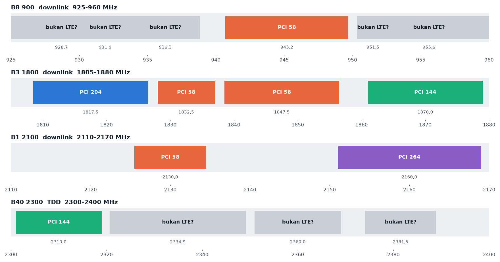

**Ulasan & Anotasi Visual:**
- **Pewarnaan Seragam Menandakan Sektor Bersama:**
  - Blok berwarna **oranye (PCI 58)** muncul serempak di pita B8 (945.2 MHz), B3 (1832.5 MHz), B3 (1847.5 MHz), dan B1 (2130.0 MHz).
  - Blok berwarna **hijau (PCI 144)** muncul di pita B3 (1870.0 MHz) dan B40 TDD (2310.0 MHz).
  - Blok berwarna **ungu (PCI 264)** berada di pita B1 (2160.0 MHz) dan **biru (PCI 204)** di pita B3 (1817.5 MHz).
- **Blok Abu-Abu ("Bukan LTE?"):** Merepresentasikan sinyal non-LTE yang menempati spektrum, seperti kanal 2G GSM atau transmisi 5G NR n40.

### 7.4 Jawaban Pertanyaan Percobaan 7
1. **Berapa carrier dan berapa sel LTE yang terdengar? Pita mana yang paling ramai?**  
   *Jawaban:* Berdasarkan pemindaian otomatis di lokasi pengamatan, terdeteksi **16 carrier lebar**, dengan **8 sel LTE berhasil didekode MIB-nya secara valid**, serta **3 garis sempit berkarakteristik sinyal 2G GSM**. Pita yang paling ramai dan padat adalah **Band 3 (1800 MHz)** dan **Band 8 (900 MHz)**.
2. **PCI mana yang muncul di lebih dari satu carrier? Apa artinya bagi operator?**  
   *Jawaban:*
   - **PCI 58** muncul di 4 carrier berbeda: 945.2 MHz (B8), 1832.5 MHz (B3), 1847.5 MHz (B3), dan 2130.0 MHz (B1).
   - **PCI 144** muncul di 2 carrier berbeda: 1870.0 MHz (B3) dan 2310.0 MHz (B40).  
   *Artinya bagi Operator:* Operator menerapkan arsitektur **Multi-Carrier / Carrier Aggregation (CA)** pada satu sektor fisik antena eNodeB yang sama. Operator secara sengaja mengonfigurasi PCI yang identik pada seluruh frekuensi pembawa dalam satu sektor fisik untuk mempermudah koordinasi *Primary Component Carrier* (PCC) dan *Secondary Component Carrier* (SCC), menyederhanakan manajemen handover, serta memastikan antena sektoral yang mencakup sektor geografis yang sama memancarkan identitas yang konsisten.
3. **Di carrier yang berisi dua PCI, bagaimana kamu tahu keduanya berasal dari eNodeB yang berbeda?**  
   *Jawaban:* Kita mengetahuinya dengan membandingkan dua parameter temporal: **waktu awal frame radio ($t_{\text{frame}}$)** dan nomor **System Frame Number (SFN)** dalam satu rekaman IQ yang sama. Sel-sel yang dikendalikan oleh satu modul baseband eNodeB fisik yang sama pasti berbagi clock perangkat keras yang identik, sehingga awal frame mereka tiba pada waktu yang bersamaan ($\Delta t \approx 0$) dan nomor SFN-nya bernilai sama persis. Sebaliknya, apabila terdeteksi dua PCI dengan perbedaan waktu tiba awal frame (misalnya selisih $0,55\text{ ms}$) atau nomor SFN yang berbeda (misalnya SFN 855 vs SFN 833), hal tersebut membuktikan secara fisik bahwa sinyal tersebut dipancarkan oleh **dua unit perangkat eNodeB fisik yang terpisah di lokasi berbeda**.
4. **Apakah ada jam yang bukan waktu GPS? Mengapa sebuah eNodeB bisa tidak tersinkron GPS?**  
   *Jawaban:* Ya, pada berkas `survei_catatan.txt`, terdeteksi kelompok sel dengan label **Jam A** memiliki nilai fase SFN sebesar **7488,6 ms**, yang memiliki selisih $-111\text{ ms}$ terhadap waktu acuan GPS absolut. Ini menunjukkan bahwa eNodeB tersebut beroperasi dengan basis waktu internal (*local unsynchronized clock*). Sebuah eNodeB 4G FDD bisa tidak tersinkron ke GPS karena:
   - **Karakteristik Alami FDD:** Standar 3GPP tidak mewajibkan sinkronisasi fase waktu absolut berbasis GPS untuk sistem FDD (FDD hanya mewajibkan stabilitas frekuensi radio $\pm 0,05\text{ ppm}$). Berbeda dengan TDD yang mewajibkan sinkronisasi waktu ketat antar-BTS agar slot downlink tidak saling bertubrukan dengan slot uplink, BTS FDD memisahkan arah transmisi dengan frekuensi sehingga dapat beroperasi mandiri tanpa GPS.
   - **Kendala Fisik Antena GPS:** Antena penerima GPS di tower eNodeB mungkin mengalami kerusakan, terhalang gedung-gedung tinggi (*urban canyon effect*), atau kabel feeder GPS terputus.
   - **Sinkronisasi Berbasis Jaringan IP:** Operator mengandalkan protokol sinkronisasi berbasis paket melalui jaringan backhaul seperti IEEE 1588v2 PTP (*Precision Time Protocol*) atau *Synchronous Ethernet* (SyncE), yang rentan memiliki offset delay jaringan tertentu terhadap waktu GPS satelit.
5. **Mengapa SDR tidak bisa mengukur jarak ke tower, sedangkan ponsel bisa (Timing Advance)?**  
   *Jawaban:*
   - **Ponsel (UE) Melakukan Komunikasi Dua Arah (*Bidirectional*):** Ponsel memiliki pemancar dan penerima aktif. Pada saat inisiasi koneksi (PRACH), ponsel memancarkan sinyal ke eNodeB. Base station eNodeB mengukur waktu tunda rambat bolak-balik (*Round-Trip Time* / RTT) sinyal tersebut dan mengirimkan parameter perintah **Timing Advance (TA)** ke ponsel. Karena nilai TA mengompensasi delay propagasi bolak-balik ($2 \times d / c$), ponsel dapat menghitung jarak fisik ke tower dengan rumus:

$$
d = \frac{c \times (\text{TA} \times 16 \times T_s)}{2} \approx \text{TA} \times 78{,}12\text{ meter}
$$

- **SDR Bertindak Sebagai Penerima Pasif (*Receive-Only / One-Way*):** Perangkat SDR HackRF One dalam praktikum ini hanya mendengarkan gelombang radio di udara tanpa memancarkan sinyal balasan ke eNodeB (eNodeB tidak mengetahui keberadaan SDR). Karena SDR tidak mengetahui secara persis pada mikrodetik ke berapa sinyal tersebut meninggalkan antena eNodeB (*no absolute transmission timestamp*), SDR tidak dapat mengukur waktu tempuh satu arah (*one-way Time-of-Flight*) gelombang radio. Akibatnya, jarak fisik ke tower tidak dapat dihitung secara langsung hanya dari penerimaan pasif SDR.
6. **Carrier mana yang tidak berisi sel LTE? Dari bentuk sinyalnya (Percobaan 3 dan 5), apa dugaanmu?**  
   *Jawaban:*
   - Carrier pada pita B8 900 MHz (**928.7 MHz, 931.9 MHz, 936.3 MHz, 951.5 MHz, dan 955.6 MHz**) serta pita B40 2300 MHz (**2334.9 MHz, 2360.0 MHz, dan 2381.5 MHz**) tidak menghasilkan korelasi PSS/SSS LTE dan gagal dalam decoding MIB.
   - **Dugaan Berdasarkan Bentuk Sinyal:**
     - Pada **936.3 MHz dan 951.5 MHz (B8):** Berdasarkan analisis Percobaan 6, spektrum menunjukkan punuk-punuk sempit selebar 200 kHz dengan struktur frame TDMA dan burst FCCH nada $+67,7\text{ kHz}$. Sinyal ini dipastikan merupakan **kanal 2G GSM**.
     - Pada **928.7 MHz dan 931.9 MHz (B8):** Merupakan sinyal pita lebar warisan 3G WCDMA/UMTS (bandwidth kanal nominal 5 MHz) atau interferensi pembawa non-LTE.
     - Pada **2334.9 MHz (B40):** Memiliki spektrum terisi sangat lebar yaitu **28,43 MHz**. Sinyal ini dipastikan merupakan transmisi **5G New Radio (5G NR band n40)** yang menggunakan konfigurasi *Synchronization Signal Block* (SSB) dengan subcarrier spacing 30 kHz, sehingga tidak merespons algoritma korelasi PSS LTE 15 kHz.
     - Pada **2360.0 MHz dan 2381.5 MHz (B40):** Merupakan alokasi kanal operator Smartfren TDD dengan level daya penerimaan yang sangat lemah pada titik pengukuran (di bawah ambang sensitivitas decoding MIB).

---

## Rekonstruksi Peta Kampus: Topologi Tower, Sektor, & Operator

Berdasarkan hasil survei inventarisasi sel LTE (Percobaan 7) yang dikombinasikan dengan pencocokan EARFCN dan PCI pada basis data seluler publik (NetMonster / CellMapper), berikut adalah rekonstruksi topologi stasiun pangkalan di sekitar area kampus:

```
                                  [ UTARA ]
                                      ▲
                                      │
                                      │
           (Tower 2: Indosat Ooredoo) │
                    [eNodeB 2]        │
                   PCI 264 / 204      │
                         \            │
                          \           │
                           \          │
    ────────────────────────\─────────┼─────────────────────────► [ TIMUR ]
                             \        │
                              ▼       │
                       ┌──────────────┴──────────────┐
                       │   LOKASI PENGUKURAN SDR     │
                       │     (Gedung Lab Kampus)     │
                       └──────────────┬──────────────┘
                                     /
                                    /
                                   /
                                  /
                             [eNodeB 1]
                     (Tower 1: Telkomsel Macro)
                    Sektor 1: PCI 58 (B8/B3/B1)
                    Sektor 2: PCI 144 (B3/B40)
                                      │
                                      ▼
                                 [ SELATAN ]
```

### Rincian Alokasi Tower & Sektor:
1. **Tower 1 — Macrocell Telkomsel (Sisi Selatan Kampus):**
   - **Sektor Utama (Menghadap Kampus - PCI 58):**
     - Mengoperasikan 4 carrier multi-band agregasi: Band 8 (945.2 MHz, 10 MHz), Band 3 (1832.5 MHz & 1847.5 MHz, 20 MHz), dan Band 1 (2130.0 MHz, 10 MHz).
     - Menggunakan sinkronisasi clock internal seragam (**Jam A, fase SFN ~7489 ms**).
     - Memiliki konfigurasi 4 port antena MIMO di pita 1800/2100 MHz dan 2 port antena di pita 900 MHz.
   - **Sektor Kedua (PCI 144):**
     - Mengoperasikan carrier Band 3 (1870.0 MHz, 20 MHz) dan Band 40 TDD (2310.0 MHz, 20 MHz).
     - Berbagi jam baseband yang sama dengan PCI 58 (fase SFN ~7487–7489 ms).
2. **Tower 2 — Macrocell Indosat Ooredoo Hutchison (Sisi Barat Laut Kampus):**
   - Mengoperasikan PCI 264 di Band 1 (2160.0 MHz, 20 MHz, 2 port antena).
   - Mengoperasikan PCI 204 di Band 3 (1817.5 MHz, sinyal relatif lemah $-118\text{ dBm}$).
3. **Cakupan 5G NR (Tower Bersama):**
   - Terdeteksi carrier aktif selebar 28.43 MHz di frekuensi 2334.9 MHz (Band n40), menyediakan konektivitas pita lebar generasi kelima di lingkungan universitas.

---

## Diskusi: Analisis Batas Pengamatan SDR pada Arsitektur EPS (4G LTE)

Dalam arsitektur *Evolved Packet System* (EPS) jaringan 4G LTE, sistem terbagi menjadi dua segmen utama: jaringan akses radio **E-UTRAN** (*Evolved Universal Terrestrial Radio Access Network*) dan jaringan inti paket **EPC** (*Evolved Packet Core*).

### Matriks Observabilitas Komponen Arsitektur EPS:

| Node / Entitas Arsitektur | Segmen Jaringan | Teramati oleh SDR? | Alasan Teknis & Batasan Fisik |
|---|---|---|---|
| **User Equipment (UE)** | Pengguna | **BISA (Sebagian)** | Teramati melalui emisi gelombang radio Uplink pada antarmuka $U_u$ (burst SC-FDMA, PRACH, PUCCH, PUSCH). Namun, payload data pengguna dienkripsi penuh. |
| **eNodeB (Base Station)** | E-UTRAN | **BISA (Penuh)** | Memancarkan gelombang elektromagnetik secara terbuka di udara pada antarmuka $U_u$. Sinyal broadcast fisik (PSS, SSS, PBCH/MIB, CRS) dipancarkan tanpa enkripsi untuk seluruh perangkat. |
| **MME (Mobility Management Entity)** | EPC (Core) | **TIDAK BISA** | MME adalah entitas kontrol murni yang berada di fasilitas core network tertutup. Berkomunikasi dengan eNodeB melalui antarmuka **S1-MME** yang ditransmisikan via kabel fiber optik (*IP backhaul*). MME tidak memiliki pemancar radio nirkabel. |
| **SGW (Serving Gateway)** | EPC (Core) | **TIDAK BISA** | Berfungsi sebagai router data bidang pengguna (*user plane*) yang menjembatani eNodeB dan PGW melalui antarmuka **S1-U** dan **S5/S8**. Seluruh jalur komunikasi menggunakan jaringan kabel serat optik berkecepatan tinggi terisolasi. |
| **PGW (PDN Gateway)** | EPC (Core) | **TIDAK BISA** | Titik terminasi menuju jaringan eksternal Internet (*SGi interface*). Seluruh infrastruktur berbasis perangkat keras data center tertutup tanpa pancaran radio udara. |
| **HSS (Home Subscriber Server)** | EPC (Core) | **TIDAK BISA** | Basis data master pelanggan dan modul autentikasi kriptografi (berkomunikasi via protokol Diameter pada antarmuka kabel **S6a**). |

### Pembahasan Mendalam:
1. **Batas Fisik Antarmuka Radio ($U_u$ Interface):**  
   Perangkat SDR (HackRF One) dilengkapi dengan antena RF yang secara eksklusif hanya dapat menangkap gelombang elektromagnetik transversal yang merambat bebas di atmosfer pada antarmuka udara $U_u$ antara eNodeB dan UE. Seluruh antarmuka jaringan inti LTE—seperti $S1\text{-MME}$, $S1\text{-U}$, $S5/S8$, $S6a$, dan $S11$—beroperasi di atas jaringan transport fisik kabel serat optik (*optical fiber*) menggunakan protokol jaringan IP berkecepatan tinggi (GTP-U, SCTP, Diameter). Karena kabel serat optik memandu cahaya di dalam inti kaca tanpa meradiasikan gelombang radio ke lingkungan luar, perangkat SDR secara fisik mustahil dapat menyadap antarmuka tersebut.
2. **Lapisan Kriptografi & Keamanan LTE:**  
   Bahkan pada antarmuka udara $U_u$, informasi yang berhasil didekode oleh SDR dalam praktikum ini secara ketat terbatas pada **sinyal siaran lapisan fisik (*physical layer broadcast signals*)** yang memang wajib dipancarkan secara terbuka dan tanpa enkripsi agar semua ponsel dapat menemukan sel (PSS, SSS, MIB, dan informasi alokasi frekuensi).  
   Segera setelah ponsel memulai proses *LTE Attach* dan pembentukan *EPS Bearer*, protokol keamanan 3GPP mengaktifkan mekanisme enkripsi dan perlindungan integritas (*ciphering & integrity protection*) menggunakan algoritma standar militer (seperti 128-bit AES atau SNOW 3G). Enkripsi diterapkan pada tingkat:
   - **AS (*Access Stratum*):** Mengamankan kanal data kontrol radio (RRC) dan data paket pengguna (PDCP) antara ponsel dan eNodeB menggunakan kunci enkripsi $K_{eNB}$.
   - **NAS (*Non-Access Stratum*):** Mengamankan komunikasi pensinyalan antara ponsel dan MME menggunakan kunci enkripsi $K_{NASenc}$.
   Kunci-kunci sesi ini diturunkan secara dinamis dari kunci master rahasia $K$ yang tersimpan aman di dalam chip fisik kartu USIM dan modul *Authentication Center* (AuC/HSS). Tanpa akses fisik ke kartu USIM dan tanpa kemampuan memecahkan algoritma enkripsi modern, SDR pasif tidak akan pernah dapat mendekode aliran data IP, identitas IMSI, maupun paket percakapan pengguna.

---

## Kesimpulan

Berdasarkan seluruh rangkaian percobaan, analisis data, dan visualisasi pemrosesan sinyal yang telah dilakukan, dapat disimpulkan bahwa:
1. **Alokasi Spektrum Seluler Indonesia:** Spektrum frekuensi nasional di rentang 700–2700 MHz dialokasikan secara terstruktur untuk moda FDD (B5 850 MHz, B8 900 MHz, B3 1800 MHz, B1 2100 MHz) dan moda TDD (B40 2300 MHz). Carrier LTE 20 MHz memiliki lebar transmisi efektif $18,0\text{ MHz}$ (100 Resource Block $\times$ 180 kHz) dengan guard band $2\text{ MHz}$ untuk mencegah interferensi lintas-operator.
2. **Dinamika FDD vs TDD:** Pada moda FDD, pemancar downlink eNodeB beroperasi 100% kontinu tanpa jeda untuk menyediakan sinyal referensi broadcast, sedangkan uplink ponsel bersifat sporadis (*bursty*) mengikuti penjadwalan dinamis. Pada moda TDD (B40), downlink dan uplink berbagi kanal frekuensi yang sama secara bergantian waktu dengan siklus periodik 5,0 ms dan rasio aktif downlink sebesar 80% (Uplink-Downlink Configuration 2).
3. **Karakteristik OFDMA & SC-FDMA:** Downlink LTE mengonfirmasi ortogonalitas subcarrier $\Delta f = 15,00\text{ kHz}$ dengan durasi simbol berguna $T_u = 66,67\ \mu\text{s}$ dan perlindungan Cyclic Prefix normal $4,69\ \mu\text{s}$ (durasi total simbol $\approx 71,4\ \mu\text{s}$, 7 simbol per slot 0,5 ms). Sementara itu, arah uplink ponsel mengadopsi SC-FDMA untuk menekan nilai PAPR guna menghemat konsumsi daya baterai perangkat portabel.
4. **Keberhasilan LTE Cell Search:** Algoritma korelasi PSS (deret Zadoff-Chu) dan SSS berhasil mengidentifikasi Physical Cell ID (PCI 144) beserta parameter Master Information Block (MIB: bandwidth 20 MHz, 4 port antena MIMO berbasis SFBC, SFN 450) dengan verifikasi CRC-16 multi-frame bebas kesalahan.
5. **Keteraturan Sistem 2G GSM:** Sinyal 2G GSM terbukti membagi pita menjadi kanal sempit 200 kHz dengan struktur frame TDMA 4,615 ms (8 timeslot $\times$ 577 $\mu\text{s}$). Kanal kendali BCCH memancarkan burst nada murni FCCH $+67,7\text{ kHz}$ mengikuti pola multiframe 51-frame (selang 10-10-10-10-11 frame).
6. **Batas Pengamatan SDR:** Software-Defined Radio pasif hanya dapat mengamati lapisan fisik terbuka pada antarmuka udara radio $U_u$ antara eNodeB dan UE. Elemen inti jaringan EPC (MME, SGW, PGW, HSS) tidak memancarkan gelombang radio karena beroperasi di atas jaringan transport serat optik terenkripsi yang secara fisik berada di luar jangkauan observasi antena nirkabel.
